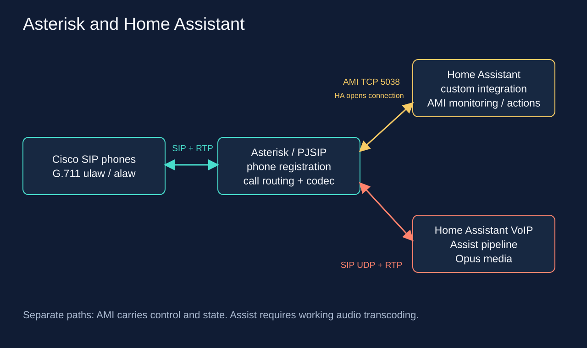

# Asterisk telephony for Home Assistant

Monitor SIP phones, call a pair of handsets, end an active call, test DTMF
safely, and reach Assist through extension **630**.

This project uses the existing
[TECH7Fox/asterisk-hass-integration](https://github.com/TECH7Fox/asterisk-hass-integration),
version **1.0.5**. It adds a verifiable installer, a local configuration
generator, examples, documentation, and SVG diagrams. Upstream source code
is not redistributed here.



## What is ready

- The installer verifies the pinned ZIP with SHA-256. By default, it only
  prepares a staging directory. It does not restart HA or change the cluster.
- The generator creates an HA package, a separate privacy package, and a
  dashboard using **actual entity IDs** supplied from your HA instance.
  It does not need the AMI password.
- The call script rings **201** first, then connects it to **202** after answer.
  Hangup reads the current `Channel` attribute and checks for a connected call.
- The DTMF example only displays a notification inside HA and is disabled by default.
- Assist has a separate SIP and audio path. **Working AMI does not prove that
  Assist works**: a G.711↔Opus transcoder and a live call test are required.

Repository checks run locally and in GitHub Actions on `ubuntu-24.04`, without
secrets, calls, or deployment. On October 17, 2026, the Asterisk and VoIP
integrations were connected to a running HA 2026.10.0 instance; the real AMI
connection was verified and a telephony status dashboard was created.
[Server deployment record](https://github.com/4alvit/cisco-home-telephony/blob/main/docs/server-validation.md).
Physical phones, call control, and audio still require acceptance testing.
[Acceptance checklist](docs/acceptance.md).
[Completed test results](docs/runtime-verification.md) link to successful
Actions runs in both repositories.

## Getting started

1. Read the [requirements and PBX contract](docs/pbx-contract.md).
2. Choose the [pinned installer](docs/installation.md) or
   [HACS](docs/hacs.md). There are
   [separate instructions](docs/ha-container-k3s.md) for HA Container in k3s.
3. Add the Asterisk integration through the HA UI, then copy each phone's
   entity IDs from Settings → Devices & services → Entities.
4. Prepare the local configuration. Placeholders are deliberately rejected:

```bash
umask 077
mkdir -p .local
cp examples/site.example.json .local/site.json
# Enter the actual entity IDs in .local/site.json.
python3 scripts/render.py --input .local/site.json --output .local/rendered
```

5. Install the three generated YAML files using the
   [package and dashboard instructions](docs/configuration.md), run a config
   check, then perform acceptance tests. Python 3.10+ and its standard library
   are required.

## Documentation

- [Installation with SHA-256 verification and rollback](docs/installation.md)
- [HACS without a second installer](docs/hacs.md)
- [HA Container, PVC, and host networking in k3s](docs/ha-container-k3s.md)
- [AMI, permissions, Assist 630, and the PBX contract](docs/pbx-contract.md)
- [Entities, actions, DTMF, and dashboard](docs/configuration.md)
- [Privacy and access boundaries](docs/privacy.md)
- [Operations and troubleshooting](docs/operations.md)
- [Acceptance testing](docs/acceptance.md)
- [Real HA runtime tests with modeled AMI](docs/runtime-verification.md)
- [Primary sources and pinned versions](docs/sources.md)

Edit SVG files as text or in an SVG editor. To rebuild them, run
`python3 scripts/build_diagrams.py`. The `*.example.yaml` files contain
**explicitly synthetic** `example_*` IDs and are for reference, not installation.

## Development

```bash
python3 -m venv .venv
.venv/bin/python -m pip install -r requirements-test.txt
.venv/bin/python -m unittest discover -s tests -v
python3 -m compileall -q scripts tests
python3 scripts/build_diagrams.py --check
```

Do not commit local entity maps, home IP addresses, residents' names, AMI
passwords, `.storage`, HA backups, call recordings, or purchase information
to public Git.

## Repository management

The public [ha-homelab/asterisk-telephony](https://github.com/ha-homelab/asterisk-telephony)
repository was created through the canonical
[terraform-github-ha-homelab](https://github.com/4alvit/terraform-github-ha-homelab/tree/687eb21afa585b535ab619f159d0bb1707f620b5)
configuration in [PR #53](https://github.com/4alvit/terraform-github-ha-homelab/pull/53).
GitHub repository settings are managed through Terraform. Content and
documentation use ordinary commits and PRs. Scripts in this repository do
not create GitHub resources.
