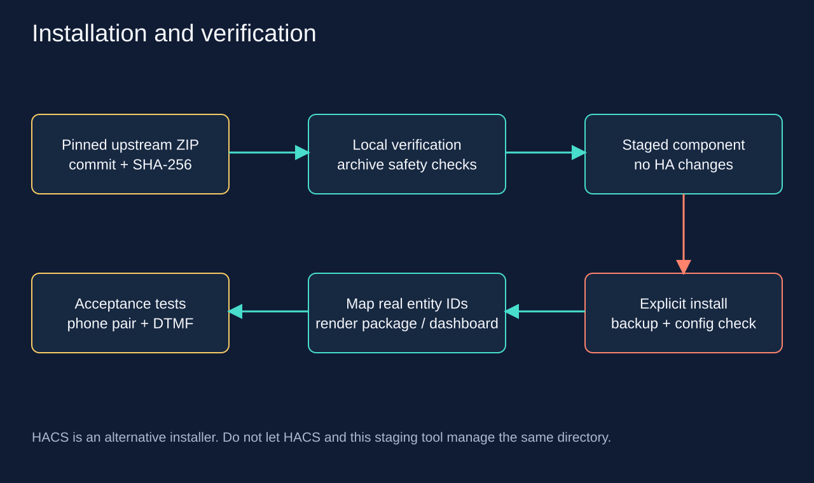

# Pinned installation

## What gets installed

`upstream.lock.json` pins the source ZIP for
`TECH7Fox/asterisk-hass-integration` to commit
`65ea9d637a58d6edb3b2bc9e8a6f90de896a9b3e`, manifest version `1.0.5`.
SHA-256:
`697792a522eb90db62672ff57bc0b03bec4caba45c0748583bdd32768e6dcad1`.
This verifies the selected archive; it is not the author's cryptographic
signature. Upstream may regenerate the ZIP. A mismatch requires checking the
source and files, not automatically accepting a new hash. [Provenance](sources.md).

The installer uses only GitHub/codeload over HTTPS, limits archive size, checks
SHA-256 before extraction, rejects path traversal, symlinks, and duplicate names,
extracts only `custom_components/asterisk`, and verifies the domain and version.
By default, it does not touch the running HA instance.

## Staging

```bash
python3 scripts/stage_integration.py --stage .local/upstream-stage
```

Output: `.local/upstream-stage/custom_components/asterisk/`.
For an archive downloaded in advance:

```bash
python3 scripts/stage_integration.py \
  --archive .local/upstream.zip --stage .local/upstream-stage-offline
```

SHA-256 and size are checked in offline mode too. Do not upload the archive or
extracted component to this public repository. Existing staging directories are
not overwritten; choose a new path.

## Installing into a locally accessible /config

1. Back up HA, including `.storage`, and preserve the current
   `custom_components/asterisk` directory if it exists.
2. Stop HA while replacing files. For HA Container, use your usual container
   management procedure; for k3s, use the accompanying container instructions.
3. If HACS already manages the integration, update it through HACS. Do not let
   two installers manage the same directory.
4. For a fresh installation, supply the actual existing configuration directory:

```bash
python3 scripts/stage_integration.py \
  --stage .local/upstream-install-stage \
  --install-to /absolute/path/to/ha-config --apply
```

Without `--apply`, even `--install-to` only stages and validates files.
The script requires `configuration.yaml`, rejects symlinks in the path, and
refuses to overwrite an installed integration. On macOS, `/tmp` and `/var` may
be system symlinks; use the canonical path. New files use mode `0600` and
directories use `0700`. Run as the owner of the HA configuration, or set ownership
to the container's UID/GID before starting it. Do not make the configuration
readable by everyone.

5. Check the configuration and start HA. In Settings → Devices & services,
   add **Asterisk** and enter the PBX LAN/VPN address, port `5038`, and the AMI
   username and password from private storage. The phone's SIP password is
   not the AMI password.

On first startup, the integration may install Python dependencies listed in
its manifest; account for HA's access to the package registry. This repository's
installer does not execute the downloaded component's code.

## Rollback

Preserve the current `.storage` and stop HA. Move the new component to a local
quarantine directory, restore the previously saved version compatible with
your HA, check the configuration, and start HA. Do not delete the config entry
or entity registry as a first step: this may break the mapping. Roll back
packages and the dashboard separately using their previous files.


