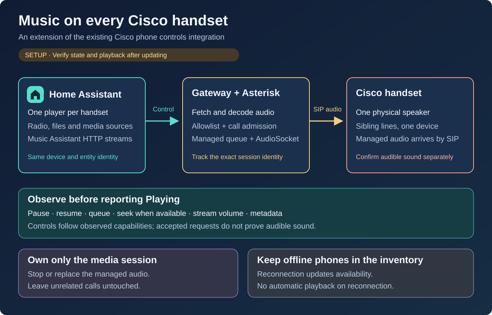

# Radio playback on a Cisco phone

The media-player candidate extends **Cisco phone controls** (`cisco_phone_control`)
on each existing handset device. It belongs to this
[Terraform-managed repository](../README.md#repository-management); it does not
require another repository or a second phone integration. **Deployment and
physical playback acceptance are pending.** The behavior below describes the
candidate, not a claim that it is installed in your Home Assistant instance.



## One player per handset

Discovery creates one **Radio** media-player entity for each configured physical
phone,
including offline phones. An inventory of ten handsets therefore creates ten
players. Two SIP lines on one handset share its device and player; they do not
become two speakers. Copy the actual entity ID from **Settings → Devices &
services → Entities**. All entity IDs below are synthetic examples.

An offline phone is **Unavailable**. After it reconnects, successful inventory
updates restore availability automatically. This does not replay a station or
queue a request made while the phone was offline. HA startup still needs the
integration's normal successful gateway inventory.

The catalog contains only services classified as radio and permitted by the
gateway's dialing allowlist. Inspect the entity's `source_list` for the available
choices, formatted as `number — label`. The player's **Radio stations** browser
shows the same catalog. Station availability and names come from that catalog;
installing this component does not subscribe to a streaming service.

## Install the compatible component and gateway

Use the existing [Cisco phone controls installation](phone-controls.md#install-and-connect)
to update `custom_components/cisco_phone_control`, preserving the configuration
entry and entity registry. Install a compatible gateway that advertises the
`media` capability, exposes `phone.media` in its inventory, and provides the
catalog and guarded radio controls. Updating only the HA component against an
older gateway leaves the player unavailable; it cannot establish radio state.
This is a separate candidate capability, not a claim about the existing Beta17
gateway release. Keep component backups outside `custom_components`, as
described in the [installation guide](installation.md).

The matching gateway also requires a regenerated and activated **PBX radio
dialplan**. Its `CISCO_RADIO` marker binds each radio call to its station and
channel unique ID. Updating the gateway without activating that dialplan is
insufficient: an unmarked radio call remains **Unknown**, and missing capability
or missing fresh inventory leaves the player **Unavailable**. Neither condition
authorizes radio Stop or a claim of Playing.

Regenerate the PBX configuration with the matching provisioning version, then
activate it using the deployment's configuration update procedure. Reload the
dialplan only if the running PBX can read the updated files. If `/etc/asterisk`
comes from an [immutable Kubernetes Secret](https://kubernetes.io/docs/concepts/configuration/secret/#secret-immutable), create a replacement Secret and
update the workload reference, then plan a PBX workload recreation to mount it;
a dialplan reload alone cannot activate those replacement files. A PBX restart
interrupts active calls. Verify the new dialplan is active before testing the
media player.

After the coordinated update and HA restart, find the media player on each
existing phone device. Check an online and an offline handset. Keep the existing
Asterisk integration, native Assist pipelines and private gateway credentials.
This candidate adds no pause, seek, volume or current-song metadata controls.
The displayed title identifies the station, not the track being broadcast.

To add the optional **Radio** media-control card, regenerate and review the
dashboard using the [actual-registry workflow](phone-controls.md#render-readable-dashboard-tabs).
The renderer uses the discovered entity ID and still accepts older inventories
without a media player. Preserve existing views and review the output before
applying it; the example ID below is not an installation value.

## Play a station

Choose the starting line with the handset's existing **Line** selector. Use
**Developer tools → Actions** or a dashboard targeting the actual player.
The following example requests the configured radio service `708`; this is a
service example, not a household handset number:

```yaml
action: media_player.play_media
target:
  entity_id: media_player.example_phone_radio
data:
  media_content_id: "708"
  media_content_type: music
```

Alternatively, use `media_player.select_source` with an exact value copied from
`source_list`, such as `708 — Toddler music` when advertised. Selecting a source
starts that station; it is not merely a preset for a later Play action:

```yaml
action: media_player.select_source
target:
  entity_id: media_player.example_phone_radio
data:
  source: "708 — Toddler music"
```

These are standard [Home Assistant media-player actions](https://www.home-assistant.io/integrations/media_player/),
with this integration's narrower radio-only input contract. `channel` is also
accepted as the media type for an advertised numeric station. URLs,
`media-source://` identifiers and arbitrary external phone numbers are not
accepted. The built-in Radio stations browser is supported; arbitrary media
sources, announcements and playback queues are not.

## Understand playback and stop it

A successful action means the request was accepted, not that music was heard.
**Playing** requires the gateway to observe the identified PBX radio call and
its matching **Up** AudioSocket path. It does not measure sound from the phone's
speaker. Startup, blocked admission or unknown call state must not be interpreted
as verified playback.

- **Buffering** and **Playing** come from fresh backend observations, not an
  optimistic state change when Play is pressed.
- **Idle** can also represent a blocked, non-radio call. Inspect `media_status`
  and `blocked_reason`; Idle alone does not mean the phone is safe to start.
- **Unknown** means no verified radio state. **Unavailable** covers an offline
  phone, failed/stale inventory or a gateway without the required capability.

To change stations, **Stop first**, wait for current state to confirm that radio
has ended, then select the new station. This also applies to selecting the same
station again while it is active. A source change does not implicitly hang up
an existing call:

```yaml
action: media_player.media_stop
target:
  entity_id: media_player.example_phone_radio
```

Stop applies only to the exact observed radio call. It must not terminate a
replacement call, an ordinary conversation or a voice-assistant session. The
observed line is used even if the Line selector has since changed. If the call
identity changed or a request timed out, refresh status before another action;
do not use a broad Hangup to make the player look idle. Ordinary call and voice
admission rules remain authoritative.

A Play request may ask the gateway to hand off its own supervised voice call.
The gateway decides whether that transition is allowed. Other busy or uncertain
states are refused; do not end an unrelated call to bypass admission.

For acceptance, check one deliberate station request, observed Playing, audible
output, exact Stop and return to idle. Verify that an unrelated call survives a
refused Stop, then check offline/reconnect behavior without automatic replay.
Record software observations separately from human listening results. A single
handset test does not establish playback on every configured phone.

## Why not a general network speaker?

- **URL or media-source bridge — future work.** It would need controlled media
  fetching, codec conversion, per-phone call ownership and exact cleanup. HA's
  [Media source](https://www.home-assistant.io/integrations/media_source/) exposes
  media but does not transcode it. Adding a media-player entity alone supplies
  none of those transport functions.
- **Music Assistant — not supported by this candidate.** Its
  [Home Assistant player provider](https://www.music-assistant.io/player-support/home-assistant/)
  expects compatible media playback and streaming behavior. Supporting a numeric
  radio service through `play_media` does not establish support for its streams,
  queue or metadata.
- **Cisco XML/RTP — a separate firmware-specific approach.** Cisco documents
  [internal multimedia URIs](https://www.cisco.com/c/en/us/td/docs/voice_ip_comm/cuipph/all_models/xsi/7_0/english/programming/guide/70xsi/xsi70uri.html)
  for these phones. `Play:` reads a constrained raw ring file from TFTP; it is
  not an MP3 URL player. RTP reception would require its own media conversion,
  call-priority handling and cleanup qualification. This candidate uses PBX
  radio calls instead.
- **DLNA — requires a renderer.** HA's
  [DLNA DMR integration](https://www.home-assistant.io/integrations/dlna_dmr/)
  controls devices implementing that protocol. This integration does not add a
  DLNA renderer to the phone.
- **Template or Universal wrapper — presentation only.** A
  [Universal media player](https://www.home-assistant.io/integrations/universal/)
  can map commands and state from existing entities. It cannot add an audio
  transport or turn an unobserved call into verified playback. Avoid wrappers
  that advertise unsupported pause, volume or track information.
