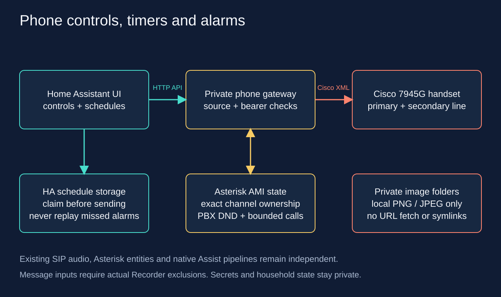

# Cisco phone controls, timers and alarms

`cisco_phone_control` is an optional Home Assistant custom integration for the authenticated [Cisco phone gateway](https://github.com/4alvit/cisco-home-telephony). It adds controls to each **physical handset**, discovered from the gateway. Two SIP lines on one phone are one device with a line selector. The existing pinned Asterisk integration, its entities and Hangup scripts, and the native VoIP/Assist pipelines remain separate.



## Install and connect

1. Deploy the gateway using its reviewed private configuration. Restrict its API to the actual Home Assistant source address, with a dedicated bearer token; retain the phone callback source restrictions. Do not expose the API to the Internet. Use HTTPS if the private path is not trusted: HTTP does not encrypt the token.
2. Add `ha-homelab/asterisk-telephony` to HACS as an **Integration**, or copy only `custom_components/cisco_phone_control` into the same relative path inside the HA configuration directory. Do not overwrite `custom_components/asterisk`.
3. Restart Home Assistant once to discover the new integration. In **Settings → Devices & services → Add integration**, choose **Cisco phone controls**. Enter the gateway origin (for example, `http://192.0.2.10:18084`) and its private token. The gateway must return fresh AMI state before setup succeeds. Update a token using the entry's **Reconfigure** menu.
4. Discover the actual new entity IDs from the registry. Before entering private messages, add the three text entities per handset to Recorder exclusions and restart HA to apply them. Each text input refuses writes until the running Recorder filter excludes its actual ID. Existing exclusions must be preserved. Excluding the **Timer remaining** sensors is also useful to avoid recording every countdown second.
5. Place only approved images in `/config/phone-images` or `/media/phone-images`; create these directories privately. These paths are deliberately outside `/config/www`. The image action rejects URLs, parent traversal, symlinks, nonregular files and files over 2 MiB. The gateway validates/decodes PNG or JPEG and fits the Cisco service image area, 298 × 156 pixels.

The example address is documentation-only. Do not copy private credentials, configuration entries, `.storage` files, or raw validation logs to Git. A full HA `check_config` log can include secrets from unrelated integrations: redirect it to a private file and report only its exit code and sanitized diagnostics.

## Render readable dashboard tabs

Export the authenticated HA WebSocket `config/entity_registry/list` result to a private JSON file. Use the actual `cisco_phone_control` config entry ID. Optionally export the current admin-only dashboard with `lovelace/config` so all its existing views are preserved:

```sh
python scripts/render_control_dashboard.py \
  --registry .local/entity-registry.json \
  --entry-id REPLACE_WITH_ACTUAL_ENTRY_ID \
  --baseline-dashboard .local/dashboard-before.json \
  --output .local/controls-review
```

The command does not contact HA. It generates one tab per discovered handset, separate Call, Message, Alarm and Timer cards, an actual entity map, and a small Recorder package containing only the new text/countdown exclusions. It rejects missing or disabled entities, duplicate identities and an existing target tab. Review the output before applying it; re-read the live dashboard immediately before saving and refuse if it changed since export. Keep the dashboard admin-only. Copy the Recorder additions into a new owned package without replacing any existing exclusions, validate privately, then restart HA to activate its filter.

## Everyday controls

Each device exposes a **Line** selector and a **Dial destination** selector containing only the gateway's configured allowlist. Choose both, then press **Dial**. Destinations include other extensions, Assist, test numbers and enabled radio stations. The phone gateway selects the physical line key before dialing; the Cisco `Dial:` URI's optional suffix is not a line index.

**Answer** and **Hang up** fetch fresh AMI state and require one active handset channel on the selected line. Answer accepts only `Ringing`; Asterisk's `Ring` means the phone itself started an outgoing call. A second concurrent call or a changed channel identity is a refusal, not a reason to guess. The gateway independently verifies the exact channel and unique ID immediately before the action.

**Speaker / dial tone toggle** is an explicit idle-only toggle. Neither HA nor the gateway knows the physical speaker or hook state, so there is no misleading speaker-on switch. Pressing it may open or close idle dial tone. Answering a ringing line normally uses speakerphone when the handset is on its cradle.

**PBX do not disturb** controls the gateway's persistent PBX DND setting, not the Cisco screen's native DND softkey. Its `pending` attribute means the desired value has not yet been reconciled with Asterisk. Gateway-originated calls obey DND. Idle screen messages and images remain available. Existing direct AMI Originate scripts do not automatically gain this check.

**Gateway auto-answer** is an explicit opt-in, off by default. The gateway answers a freshly observed, isolated incoming `Ringing` channel at most once for that call. Timer and alarm alerts are excluded, and the HA **Answer** action also refuses them: answer or reject on the physical phone, or use **Stop alert**. Auto-answer is not native Cisco provisioning or a generic SIP `Alert-Info` trick. Consider who can call the handset before enabling it.

## Optional persistent hands-free voice

Version 0.6.0b1 adds the administrator-only `cisco_phone_control.hands_free`
response action for a compatible SIP AudioSocket gateway. Installation and
status polling never enable the microphone. The gateway owns the saved setting,
finite session renewal, ordinary-call priority and recovery; HA does not run a
renewal automation. The existing attended `voice` action is unchanged.

After a configured handset returns a valid hands-free status, two read-only
entities appear on its existing device:

- **Hands-free enabled** is the saved desired setting, not evidence of listening.
- **Voice status** shows actual progress. **Ready for wake phrase** requires the
  supervisor and finite voice status to identify the same active session with
  `phase: armed` and `phase_reason: wake_ready`. Running alone is not ready.
  **Waiting for idle** does not identify a particular call or prove a call exists.

Enabled may remain on while waiting, retrying or faulted. Disabled may coexist
with Stopping while cleanup is pending. Missing, stale or invalid status becomes
Unavailable; it never means Off or Ready. The remaining-seconds attribute applies
to the current finite session, not the lifetime of the saved setting. Renewals
have startup gaps and may ring the phone; capture is not uninterrupted. Software
status does not prove audio was heard or physically stopped.

Use **Developer tools → Actions** as an administrator. The following synthetic
example explicitly enables persistent operation; use a new request key for a
new deliberate change, and retain it if the response is uncertain:

```yaml
action: cisco_phone_control.hands_free
data:
  entry_id: YOUR_CONFIG_ENTRY_ID
  phone: "201"
  line: "201"
  operation: enable
  request_id: hands-free-enable-example-001
  enable_microphone: true
  exclusive_media: true
response_variable: hands_free_result
```

Add `dry_run: true` to validate eligibility without changing the setting or
starting audio. Both literal confirmations remain required. To disable, use the
same entry/phone/line with `operation: disable` and a fresh `request_id`; omit
both enable flags and `dry_run`. No session ID is required. Disabling prevents
future sessions and requests cleanup of the currently owned one. For a read,
use `operation: status` without a request ID or enable flags. A lost response is
not permission to repeat a mutation blindly: read status first. Alias reads do
not change the selected persistent line.

These entities intentionally have no writable switch, so a generic
`switch.turn_on` cannot bypass the action's administrator boundary. Regenerate a
reviewed dashboard from actual registry IDs to add its read-only Voice card.
The renderer supports a mixture of older phones without these entities and
phones with the complete pair; existing entity IDs and other cards remain.

A valid finite Stop for the current supervised session also disables its
persistent intent. Stopping an older session does not disable a replacement;
use `hands_free` Disable for an unambiguous phone-wide request. Enabling while
faulted requires a new explicit request after resolving the fault. Ordinary
calls and unknown cleanup are handled by the gateway; HA never forces a resume.

HA reload only rereads gateway state and stops its own polling. It does not
restore an On value into a new Enable call or turn the gateway off. A clean
gateway restart may resume an already enabled setting; unresolved ownership
requires recovery. As before, initial HA setup/restart needs a valid AMI
inventory. Once loaded, hands-free polling and Disable use the known mapping
independently of subsequent AMI failures. If the entry cannot load, use the
matching gateway CLI. No native VoIP or Assist pipeline is changed.

The component and gateway must both be installed before using this feature.
Source tests cover synthetic service, status and lifecycle behavior; installing
this component alone does not establish physical phone acceptance.

## Attended voice sessions

Version 0.5 adds the administrator-only `cisco_phone_control.voice` action for the optional
[gateway voice controller](https://github.com/4alvit/cisco-home-telephony/blob/main/docs/voice-control.md).
The gateway must have an explicitly enabled private registry, a reviewed runner
runtime with its live dependencies, and persistent controller state. Installing
this HA component alone does not enable microphone access. Version 0.5.2b2 accepts
compatible gateway sessions up to 300 seconds and their optional live progress
fields. The gateway profile selects manual or wake mode and the duration; the HA
action cannot extend that duration. Older gateway responses remain supported.
This is a response action; the existing entity IDs and dashboard controls do not change.

Supply `entry_id`, the primary physical handset ID as `phone`, an exact owned
`line`, and `operation: status`, `start`, or `stop`. The action does not change the
Line selector. Status and Stop use the loaded entry's saved handset mapping and
contact the controller directly, without an AMI refresh or waiting for ordinary
call actions. They remain usable when AMI fails **after the entry has loaded**.
Initial setup, including setup after an HA restart, still needs a successful AMI
inventory. If that prevents loading, use the gateway's CLI or physical phone
Applications menu to reach voice status and Stop.

Start requires `request_id` plus literal `true` for all three fields:
`attended` (the operator is present), `exclusive_media` (phone audio is reserved
for this attempt), and `enable_microphone` (explicit microphone permission).
Strings such as `"true"` and numeric `1` are refused. The runner checks current
call/media admission; incoming calls retain priority. Use only a deliberate
operator action, never a recurring automation or an unattended start. An
integration unloading will reject new Start requests.

Wait for actual readiness before speaking. A compatible gateway reports `phase`
as `preparing`, `armed`, `listening`, `thinking`, `speaking`, `stopped`, or `error`;
`armed` with `phase_reason: wake_ready` means the wake detector is ready. The
process lifecycle `state: running` alone does not prove readiness or incoming audio.
Older gateways omit these optional fields, so use their live phone screen.
Opening HA or the phone's status menu never starts listening. Manual mode handles
one request; a configured wake session may rearm after a successful reply within
its original deadline. Stop ends that session and never automatically starts another.

While a voice lease is held, or its cleanup is uncertain, a compatible gateway
refuses remote dial, speaker, answer and display changes with `voice_phone_busy`.
Intercom checks both handsets. Incoming SIP calls, including timer/alarm rings,
retain priority through the media controller; exact hangup, alert Stop, voice
Stop and phone preferences remain available. A refusal is not a reason to retry
automatically.

This example performs validation without starting media. Replace the synthetic
identifiers with the loaded entry and its real handset mapping:

```yaml
action: cisco_phone_control.voice
data:
  entry_id: REPLACE_WITH_ACTUAL_ENTRY_ID
  phone: "201"
  line: "202"
  operation: start
  request_id: replace-with-a-new-deliberate-attempt-id
  attended: true
  exclusive_media: true
  enable_microphone: true
  dry_run: true
response_variable: voice_result
```

For an attended live attempt, explicitly set `dry_run: false` and use a new
request ID after reviewing validation. Start and Stop both require a stable
8–128 character `request_id` containing letters, digits, `_`, `.`, `:`, or `-`.
Start uses it for duplicate suppression; Stop uses it for response correlation.
Replay history is bounded to 128 in-memory records, and only the latest
per-handset journal survives controller restart. Do not automatically retry an
unknown outcome or reuse an old completed ID for a new attempt.

Stop additionally requires the exact 32-character lowercase hexadecimal
`session_id` returned for the intended attempt. Keep that ID when another
operator starts a newer session; never refresh and substitute the newer ID.
Status uses neither a request ID nor a session ID. A Stop acknowledgement means
that the controller accepted the request, not that microphone cleanup is
complete. The controller allows up to 45 seconds for cleanup after the bounded
media lease. Read status and inspect `stop_confirmed`; `recovery_required` means
cleanup or ownership is uncertain and blocks another attempt. An existing
controller can read another owner's newer journal but cannot signal that
owner's child process. Do not clear its state to force a restart.

Responses contain a correlated `status`/`action_id` envelope and a fixed typed
`voice` object: schema version, physical phone, original Start line, session ID,
state, active flag, remaining seconds (0–300), Stop flags, and a sanitized error
category. Compatible gateways may also include `phase` and fixed-code
`phase_reason`, `turns_completed` (0–10000 successful replies), `mode` (`manual` or
`wake`), and `session_seconds` (greater than 0, at most 300). Only phase and
phase reason may be null; missing optional fields remain absent. Unknown phase
reason text is reduced to null. Unknown extra fields and invalid types are refused.
The returned line can differ from the alias used for Status. A successful dry run
returns `valid`, zero `network_actions`, false `microphone_started`, and the
bounded duration, even when its request ID was used by a previous Start. Dry runs
validate the current inputs and never replay a previous session result.
No transcript, audio, private path or backend exception is returned.
These local adapter checks do not constitute physical microphone, display,
call-preemption, wake-word or unattended acceptance.

## Messages and images

Enter **Message title** and **Message text**, then press **Send message**. Enter a relative image filename such as `arrival.png`, or an absolute file path inside an approved folder, then press **Send image**. Relative filenames resolve inside `/config/phone-images`. Text input values are kept only in memory and reset when the integration reloads; they are not saved in the schedule store. The text input is limited to 250 characters by the HA entity state limit; the direct action allows up to 2,000 characters.

After a Home Assistant restart or integration reload, enter the message again. Apply or confirm the **Message text** edit before pressing **Send message**; text still being edited in the browser may not yet be saved to the entity. Both the title and message must be nonempty; an empty Send message request is rejected locally before contacting the gateway, with a prompt naming the missing field. Titles allow up to 48 characters. Unicode, newline and tab are preserved; other control characters, including carriage returns from pasted CRLF text, are rejected. You can still clear the text fields without sending anything.

If the gateway refuses a valid message because either phone line has a call, the voice assistant holds the phone, or its pending-message capacity is full, the error now gives a short reason. Finish the call or investigate the voice status before sending again. Responses remain bounded and unknown errors remain generic; the integration never retries a send automatically or includes private message content in errors.

The administrator-only actions `cisco_phone_control.send_message` and `cisco_phone_control.send_image` accept `entry_id`, the discovered primary handset ID in `phone`, and `title`, plus `text` or `path`. They avoid putting payloads into text entity states. HA automation traces and service events may still include the action inputs; keep sensitive content out of public logs and traces.

An example automation action, after substituting the actual entry ID and primary handset ID:

```yaml
action: cisco_phone_control.send_message
data:
  entry_id: REPLACE_WITH_ACTUAL_ENTRY_ID
  phone: "201"
  title: Home Assistant
  text: The front door is open.
```

The gateway pushes a phone-fetched HTTP content URL. Starting with [Cisco gateway Beta 19](https://github.com/4alvit/cisco-home-telephony/releases/tag/v0.1.0-beta.19), a manually sent text message uses HTTP priority 0 to bring it to the foreground after the existing call-state and voice-ownership checks pass. This allows the message to replace a currently open native XML application without bypassing those checks.

Images and motion snapshots continue to use priority 2, which displays only when the phone considers its application interface idle. Priority 2 can drop the request while a native XML application is busy; it does **not** queue the request for later display. Older gateway versions also used priority 2 for manual text messages. HTTP priorities do not make internal `Key:` or `Dial:` operations idle-only. Resource URLs expire after 120 seconds; an already displayed page may remain visible until the phone's **Exit** softkey is pressed.

An accepted gateway command or successful phone Execute response is not proof that the content rendered. Confirm the visible message on the phone or in a current screen capture; do not infer display success from the command acknowledgement alone.

## Recurring alarms and countdown timers

For an alarm, choose **Line**, **Alarm time**, the desired **Alarm Monday** through **Alarm Sunday** switches, and turn on **Alarm enabled**. The first configuration captures that line; changing the Line selector or disabling and re-enabling the alarm later does not redirect it. Use the atomic `alarm_set` action with explicit replacement to change its line. Time follows HA's configured local timezone. Defaults are disabled, 07:00, Monday–Friday. The autumn repeated clock hour runs once; a nonexistent spring clock time is skipped. Changing HA's timezone changes the alarm's wall-clock meaning.

For a timer, choose **Line** and **Timer minutes** (1–1,440), then **Start timer**. Starting again replaces the pending timer. The selected line and deadline are captured at start; changing the Line selector later does not redirect that timer. **Cancel timer** clears the pending countdown and stops an active timer alert. Disabling **Alarm enabled** also stops an active alarm alert. Each action affects only its matching alert kind.

A due event requests one persistent gateway alert. The phone keeps ringing until you answer or reject on the phone, or press **Stop alert** in HA. There is no automatic answer, ringing timeout, or audio after answering. Radio stations remain available through **Dial destination**; scheduled alerts do not select a radio or tone route. The gateway owns the exact alert identity and call lifecycle; HA does not repeatedly redial.

**Stop alert** uses the latest alert ID reported by the gateway, even if the Line selector has changed. It does not guess a channel or stop another call. **Timer remaining** shows a pending countdown; **Schedule status** reports the gateway's starting, ringing, stopping, ended or unknown alert state. An ended call is reported without guessing whether the person answered or rejected it. If the gateway is unavailable, canceling a pending timer still persists locally, but stopping an already ringing phone cannot be confirmed until communication returns; dismiss it physically if needed.

Schedules and pending future timers persist in HA storage. Each occurrence is saved as claimed **before** sending the request, with a stable idempotency key. If HA was offline at the due time, the missed event is not replayed on startup. A running HA that is more than 20 seconds late also skips the event. Busy handsets, DND, an existing active or unknown alert, unavailable gateways and ambiguous outcomes are not automatically retried. This avoids duplicate or surprising calls; it is not a guaranteed wake-up service.

Version 0.2 and later require a gateway with persistent-alert support. During the component upgrade, only this integration entry's obsolete **Alarm sound** and **Timer sound** selectors are removed; their old stored values remain readable but are ignored. One **Stop alert** button replaces them, resulting in 29 entities per handset. Preserve a private registry/dashboard backup, discover the actual new button IDs, and regenerate only the reviewed handset tabs while preserving other views. The existing text/countdown Recorder exclusions remain unchanged. Upgrade only with pending timers and alarms disabled and no active calls.

### Atomic scheduling for CLI clients and automations

Version 0.3 adds the administrator-only `cisco_phone_control.schedule` action. Use it instead of separate selector, duration and button requests: those requests can interleave with another client. There is **one timer slot and one alarm slot per physical handset**, shared by its lines. The action takes the actual `entry_id`, explicit `line`, and `operation`. The optional primary handset ID in `phone` must own that line; if omitted, HA requires exactly one owner in its gateway inventory. It does not change the dashboard's Line selector. Status and local cancellation remain available from that known mapping when the gateway is unavailable.

- `status` reads both slots and the latest gateway alert without modifying them.
- `timer_start` takes integer `minutes` from 1 to 1,440 and captures the explicit line. Replacing any pending timer requires `replace: true`. Stop an already ringing timer before starting another countdown.
- `timer_cancel` cancels only the selected line's timer and matching active timer alert.
- `alarm_set` takes `time` in `HH:MM`, `weekdays` as integers (Monday 0 through Sunday 6), and `enabled` (default false). Replacing a configured sibling-line alarm requires `replace: true`.
- `alarm_enable` and `alarm_disable` preserve the selected line's saved time and weekdays. Disabling also stops its matching active alarm.
- `toggle_saved_alarm` toggles an already configured alarm from either line of its handset, preserving the saved alarm's line, time and weekdays. Turning it off also stops its matching active alarm on the saved line. If no alarm is configured, it leaves the alarm unchanged and returns `not_configured`; it never creates or enables an alarm from defaults.
- `alert_stop` stops only the current alert belonging to the selected line, using a freshly checked alert ID. It never stops an unrelated call or sibling-line alert.

Every change requires a stable `request_id` (8–80 letters, digits, `_`, `.`, `:`, or `-`). Generate it once for that operation. HA persists its fingerprint before external actions. Repeating that exact request returns its recorded state without restarting a countdown; reusing the ID with different inputs is refused. Do not automatically retry an ambiguous HTTP outcome. Read `status` and resolve it explicitly. A local cancellation can persist while the gateway is unavailable; the response then reports `outcome_unknown` for the physical alert.

Replaying a completed `toggle_saved_alarm` request does not toggle the alarm again. If the original result was `not_configured`, an exact replay returns `not_configured` even if an alarm has since been configured. That result describes the original operation; the response's alarm fields show the current settings. Use a new `request_id` for a new toggle operation.

Use a response variable in an automation, or POST to `/api/services/cisco_phone_control/schedule?return_response` through authenticated HA REST. The response has `schema_version: 1`, `phone`, `line`, HA's `timezone`, `gateway_fresh`, and `operation_result`. Its `timer` includes the captured line, ID, pending `active` flag, UNIX-seconds `deadline` and `remaining_seconds`; `alarm` includes its independent line, time, weekdays and enabled/configured flags. The `alert` is separate from the pending countdown and may remain ringing after the countdown reaches zero. `operation_result` is `applied`, `replayed`, `not_active`, `not_configured`, or `outcome_unknown`.

```yaml
action: cisco_phone_control.schedule
data:
  entry_id: REPLACE_WITH_ACTUAL_ENTRY_ID
  phone: "201"
  line: "202"
  operation: timer_start
  minutes: 10
  request_id: replace-with-a-fresh-request-id
response_variable: phone_schedule
```

Existing stored alarms migrate with their previous selected line captured as `alarm_line`. No schedule is enabled by the migration, no entity IDs change, and the 29-entity count and Recorder exclusions remain unchanged. The Schedule status attributes show the captured timer and alarm lines. Dashboard controls still manage the handset's shared slots; CLI operations additionally enforce explicit line ownership.

Changing a schedule does not clear its last claimed alarm occurrence. Reconfiguring it within the same already-claimed local minute therefore does not cause a second ring.

## Deployment and rollback checks

Before changing an existing installation, capture private hashes of owned files, the actual entity registry, automation enabled states and any currently running scripts, Recorder exclusions, dashboard JSON, native VoIP identities and selected pipelines. Refuse an overwrite if the current files or dashboard differ from that baseline. Stage only this custom component; preserve every unrelated package and card.

Keep staging and backup copies outside `/config/custom_components`, for example
under `/config/.cisco-component-backups/<unique>/`. HA also scans dot directories;
a hidden copy with the same manifest domain can interfere with component loading.

Before installation or startup, check an offline copy of the planned full
`custom_components` directory, including all hidden children and the candidate:

```sh
python3 scripts/validate_component_layout.py \
  --custom-components .local/ha-layout/custom_components \
  --domain cisco_phone_control --version 0.5.1 \
  --expected-path .local/ha-layout/custom_components/cisco_phone_control
```

The validator only parses manifests: it imports no components, writes no files
and detects hidden as well as visible duplicate domains. Keep the HA configuration
check and runtime checks below; the layout check does not replace them.

After setup, check actual gateway-to-device mapping, fresh registered contacts at Asterisk, existing entities, new text privacy exclusions, schedule defaults, disabled auto-answer, and the unchanged native Assist voice selections. Add dashboard cards using **actual registered entity IDs**, not guessed names. Validate configuration privately before a controlled restart and confirm there are no active calls. Changes confined to the existing YAML script package need `script.reload`; new custom component code and Recorder exclusions require a restart.

A gateway `accepted` response confirms command acknowledgement, not a completed phone call. During acceptance, check the actual dialed extension, application, channel and unique ID. An Assist call also creates a media leg toward HA: associate it with the handset using the exact linked call ID rather than accepting every channel named `ha-assist`. Leave unrelated user calls untouched. An unplugged handset should remain configured; its offline state must not prevent testing another registered, idle handset.

For rollback, disable pending alarms/timers first, unload/remove only this integration entry, restore only its reviewed file/card/privacy changes, and restart if component files or Recorder changed. Keep the independent Asterisk/VoIP integrations and their existing control scripts. Removing this integration does not automatically reset gateway DND or auto-answer preferences; turn them off explicitly if that is part of the rollback.

## Validation

### Schedule persistence and unload in 0.5.1

Timer and alarm entity changes prepare a candidate while holding the schedule
lock. They publish that candidate in memory only after its write completes.
The schedule store retains HA's existing key and versioned JSON format, uses
private atomic files, and surfaces write/serialization errors that the ordinary
HA Store can otherwise log without raising. Shutdown-deferred or read-only
writes cannot acknowledge a new schedule.

Cancellation cannot stop a filesystem write already running in an executor.
The coordinator therefore keeps ownership until that write settles. A private
executor completion future also survives cancellation of HA's tracked jobs. If
the save acknowledges success, memory reflects the committed candidate before
deferred caller cancellation is reported. Inspect schedule status before retrying
an interrupted request. Internal save cancellation or filesystem errors can have
an uncertain on-disk outcome if replacement already occurred. A failed call does
not prove that the old file survived.
After a save failure, cancellation or unload is observed, the mutation starts
no further phone action. An already dispatched action can have an unknown outcome.

Unload fences new schedule changes and explicitly waits for the old write
owner before allowing replacement setup. A service crossing unload does not
start another save or external action. An interrupted claimed request remains
available for idempotency checks instead of being blindly repeated.

These guarantees cover the component's controlled write and reload paths;
they are not a guarantee of alarm delivery during outages or process failure.
Installing this source version and validating the running component are
separate deployment steps.

`python -m unittest discover -s tests -p 'test_phone_voice.py' -v` checks explicit voice consent, exact Stop identity, bounded typed responses and uncertain outcomes using fake clients. The pinned HA runtime also checks actual admin service dispatch, literal boolean rejection and Stop with stale AMI state.

`python -m unittest discover -s tests -p 'test_phone_controls.py' -v` covers ownership, stale evidence, image path security, persistent claims, missed events and DST behavior without HA or network access. The optional pinned HA runtime additionally exercises entity platforms, config flow, actual component setup/unload, text privacy, unknown API outcomes and storage-failure suppression:

```sh
.local/runtime-venv/bin/python -m unittest discover -s tests -p 'test_phone_controls_runtime.py' -v
.local/runtime-venv/bin/python -m unittest discover -s tests -p 'test_schedule_*.py' -v
```

These are synthetic tests, not a claim that any live handset answered an alarm. The implementation uses Home Assistant's [coordinator pattern](https://developers.home-assistant.io/docs/integration_fetching_data/) and [config-entry flow](https://developers.home-assistant.io/docs/config_entries_config_flow_handler/). Record live acceptance separately from code validation.

## Live deployment acceptance — October 17, 2026

The integration was installed on HA 2026.10.0 and verified after the controlled restart reached `RUNNING`. The actual registry contained **120 new control entities across four handsets**, with four dashboard tabs added without replacing existing views. All **6,468 pre-existing registry identities**, including **16 native VoIP entities**, were preserved; automation enabled states and the reviewed configuration hashes matched. All eight SIP contacts were available at the final validation.

Recorder exclusions increased from 67 to **83**, preserving the original entries and adding the actual text and countdown entity IDs. All **12 live text privacy gates** passed by submitting their unchanged, nonsensitive initial values through HA. This exercised the running Recorder filter rather than relying only on a configuration-file check.

The subsequent **version 0.2.0 upgrade is deployed and verified**: 116 controls, four discovered **Stop alert** buttons, and exactly eight obsolete sound selectors removed. All 6,585 registry identities outside that explicit removal were preserved. The private compare-and-swap plan retained the original component backup and the original frozen candidate; a separately recorded labels amendment identified its source commit and file hashes. Configuration validation passed, one controlled HA restart completed, and the four updated dashboard tabs matched the API readback. Recorder exclusions remained at 83. The gateway's advertised Mac and additional children's radio destinations appeared automatically with their English labels.

The initial finite-tone design had passed a one-minute timer and a Saturday alarm. For that original timer, the user confirmed its ringtone and post-answer tone. Version 0.2 supersedes that behavior. Two version 0.2 one-minute timer trials reached the first handset; the user confirmed dismissing both on the phone. These establish physical dismissal, not the planned 40-second endurance check. No HA Answer action was sent; the second trial's gateway operation records also showed no automatic Answer or Stop before the physical answer.

A version 0.2 Saturday alarm triggered at the selected local minute and remained ringing for more than 90 seconds before the PBX observed the phone answer and immediately end the alert. This verifies the selected-weekday schedule and sustained ringing. Its HA Stop attempt exposed a gateway HTTP route defect: the action-name matcher rejected the underscore in `alert_stop` with HTTP 404 before dispatch. After correcting and deploying that route, a separate physical check passed: the first handset rang, the actual HA **Stop alert** button ended that exact alert with reason `stopped`, and the PBX returned to zero channels. No fallback cleanup or settings changes were required. An internal gateway test alone would not have covered the HTTP routing defect.

The actual HA `send_message` service also passed: a CGI screenshot showed the submitted English text, private text entity states stayed unchanged, and the observed Exit softkey returned the phone to its home screen. The HA `send_image` service test remains pending. Cleanup after the alert trials verified zero remaining timer time, the alarm off, original line/time/weekdays/duration and gateway preferences restored, and **zero active PBX channels**. Accepted schedule-store receipts preserve the original baseline while recording only expected runtime fields. Detailed receipts remain private.

The subsequent batch expansion was installed and verified for **nine configured Cisco handsets: 261 controls and 133 Recorder exclusions**. Six handsets were physically connected at that checkpoint, providing twelve registered lines; three previously converted handsets were unplugged, with their identities, settings and Assist profiles preserved. The tenth handset was not yet connected. The expansion preserved all **6,599 registry identities** in its baseline, added fifty endpoint entities, and passed fifteen additional live text privacy checks. The reviewed three-package update passed configuration validation, completed one HA restart, and added five control tabs with exact dashboard readback. New alarms, timers, DND and auto-answer started disabled; the existing user settings remained unchanged.

After the last handset was connected, the final expansion passed strict verification with **ten configured handsets, 290 controls and 143 Recorder exclusions**. Five handsets were connected at this checkpoint, with ten registered physical lines; the other five configurations remain available for reconnection. All **6,818 registry identities** from the preceding baseline were preserved, including the newly configured Assist profile. The final three-package update added ten endpoint entities and three scripts, passed the actual HA configuration check, and completed one controlled restart. Its dashboard matched the saved configuration, and all three additional live text privacy gates passed. Firmware transfer on the new handset proceeded independently of that HA restart; final acceptance required both of its SIP lines to register.

Actual first calls to `630` discovered native VoIP identities for connected primary lines 210, 212, 214, 216 and 220. Their permissions and Russian Silero Baya pipeline selections were applied and read back without changing existing profiles. Line 218 was unplugged before its first discovery call, so its native Assist setup remains pending. Automated HA-originated Assist checks on all five connected primaries reached the listening state, exchanged RTP in both directions and ended through the exact owned HA Hangup control. The final 210 and 212 checks each returned the PBX to zero channels. These are signaling and media checks; they do not claim new human confirmation of the spoken response. Separate Echo 600 checks passed on 210 and 214; exhaustive echo acceptance on every secondary line is not implied.

The **version 0.3.0 atomic-scheduling upgrade is also deployed and verified**. Its private compare-and-swap plan preserved all **6,877 current registry identities**, 290 controls, 143 Recorder exclusions, dashboard contents, existing user settings and native voice profiles. The component-only update passed configuration validation and completed one planned HA restart. Actual read-only schedule service calls succeeded for all ten configured handsets, including those whose untouched defaults had not yet been written to storage. A private CLI configuration with a separate owner-only HA token file successfully read line 221's schedule and resolved it to physical handset 220. This checkpoint verifies the deployed API and CLI read path; it does not claim a new live timer or alarm mutation test for version 0.3.
