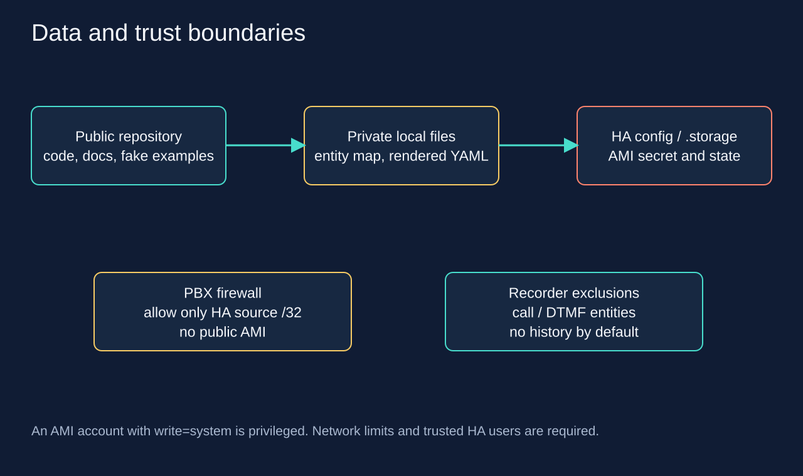

# Конфиденциальность и доступ

В public Git находятся исходники генераторов, документы, lock-файл upstream и
примеры с синтетическими ID. Реальные IP, имена помещений/жильцов, entity map,
AMI credentials, `.storage`, резервные копии и журналы остаются в `.local/`
или в вашем закрытом хранилище. `.gitignore` снижает вероятность ошибки, но не
заменяет просмотр `git diff --cached` перед публикацией.

## Что видно Home Assistant

AMI передаёт номера, имена CallerID, состояние и идентификаторы каналов, а DTMF
события могут содержать набранные цифры. Не считайте их безобидной телеметрией.
AMI password хранится в HA config entry, следовательно backup `.storage` также
является секретом. Экспорт диагностических данных и debug log проверяют перед
передачей третьим лицам. Не включайте постоянный debug upstream в общей системе
логирования: action/response могут содержать параметры вызовов.

## Recorder

Сгенерированный `asterisk_privacy.yaml` исключает Connected Line и оба DTMF
sensor каждого телефона из Recorder. Зарегистрированность и State остаются
доступны для history. Это не удаляет исторические записи, не скрывает текущие
attributes от пользователей HA и не меняет внешние log/backup-системы.
Если такие сущности раньше сохранялись, рассмотрите отдельную очистку истории
по [официальной документации Recorder](https://www.home-assistant.io/integrations/recorder/).
Не запускайте общую purge базы только ради этой интеграции.

## Доступ к AMI и HA

Обычный AMI TCP выбранной интеграции не шифрует обмен. Используйте доверенную
LAN или VPN, точный источник `/32` в ACL и host firewall. Внешние SIP/TFTP/AMI
порты не публикуются. HA-аккаунт AMI имеет привилегированный `write=system`:
одной только маскировкой опасных кнопок ограничить его нельзя.

Dashboard подтверждение защищает от случайного нажатия. Доступ к HA admin,
скриптам, разработческим инструментам и автоматизациям выдавайте только тем,
кто вправе управлять телефонией. DTMF automation по умолчанию выключена и
показывает только локальное уведомление. Для будущих бытовых действий отдельно
разберите авторизацию и ошибочные/повторные события.

Assist может отправлять аудио и текст настроенным speech/AI-провайдерам. Для
полностью локального режима выберите локальные STT, conversation agent и TTS,
проверьте их настройки и не называйте конфигурацию локальной только потому,
что телефон соединяется с домашним IP.
